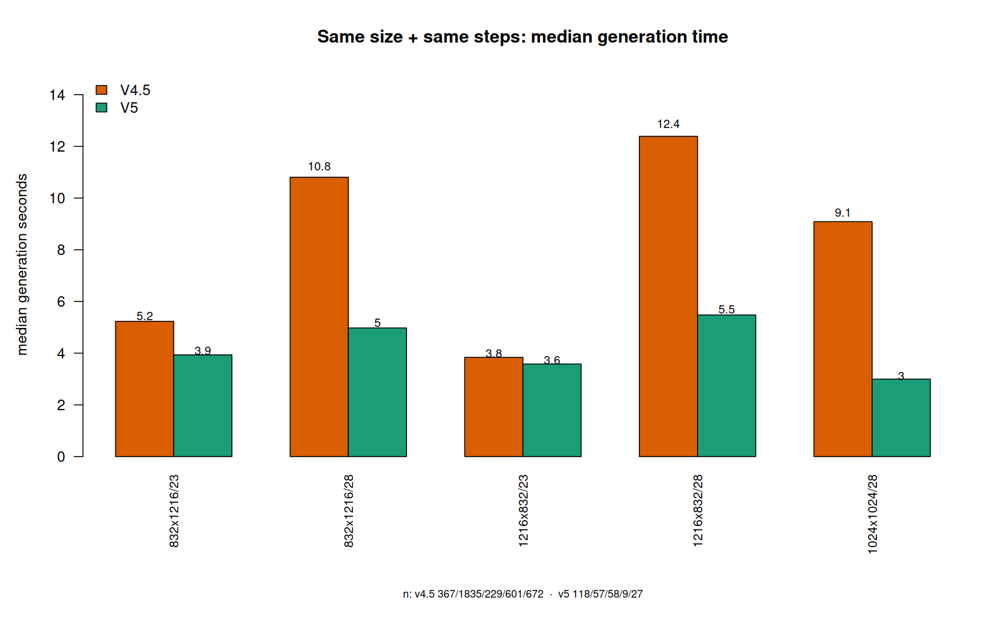
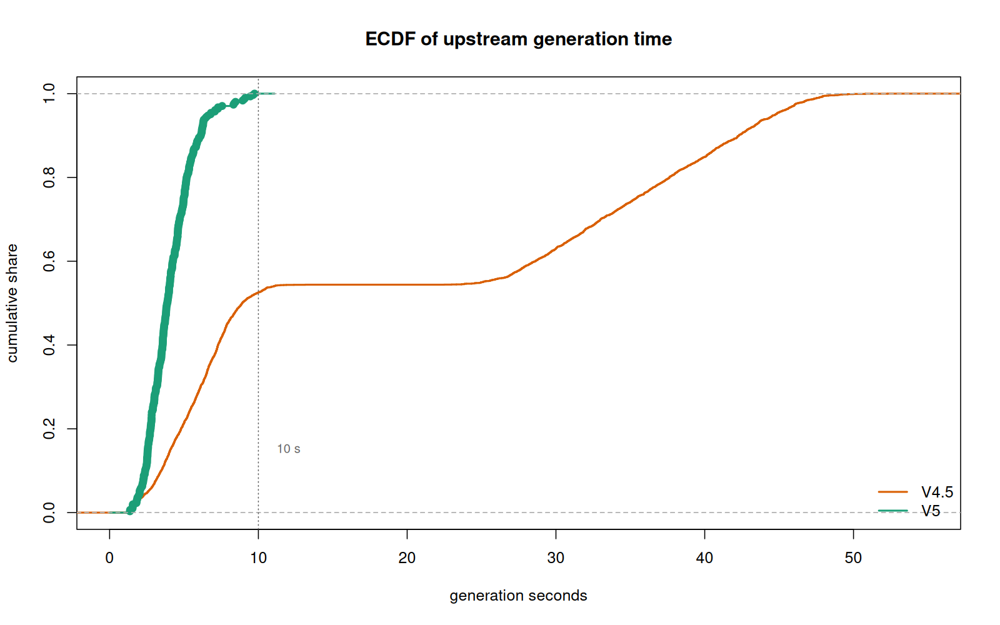
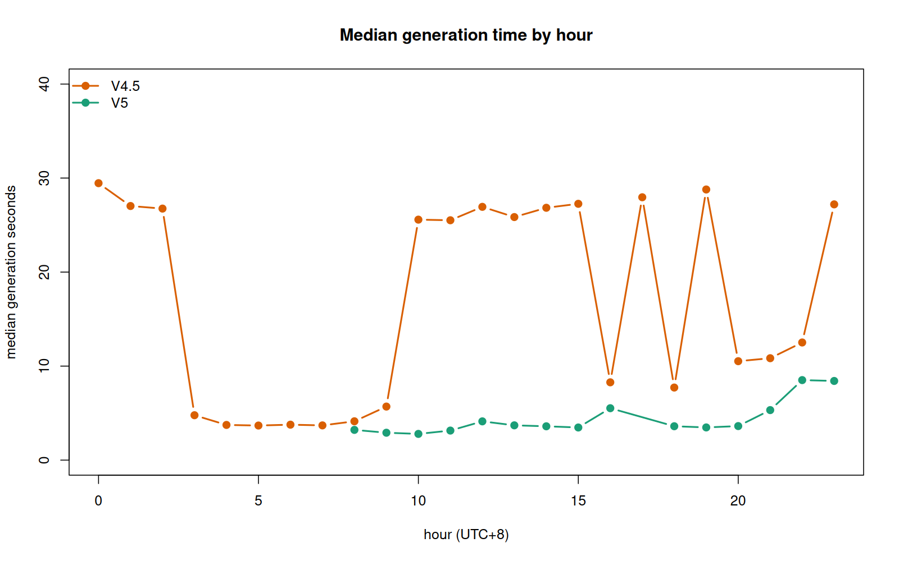
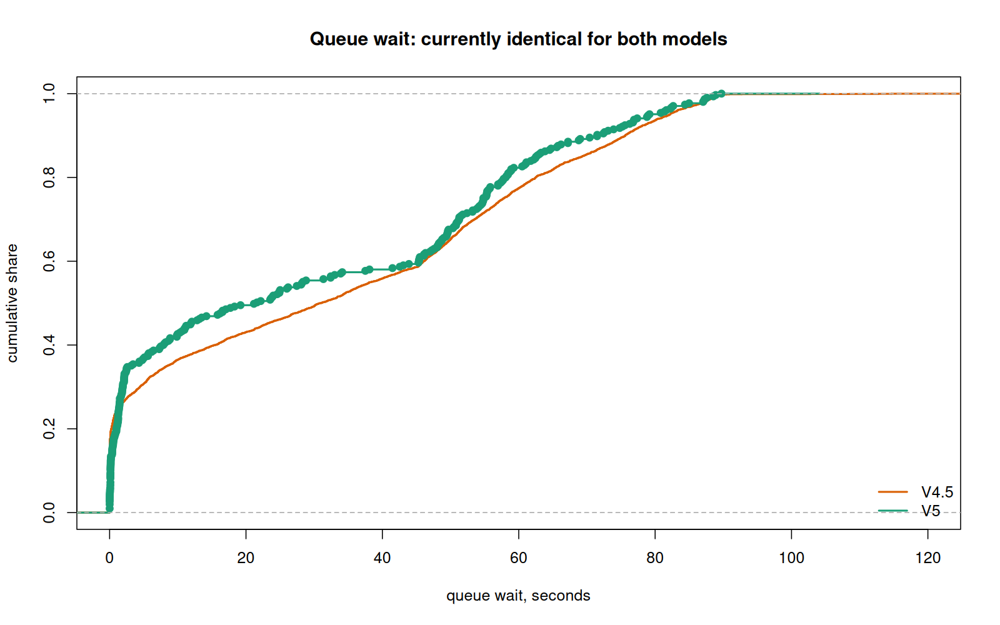
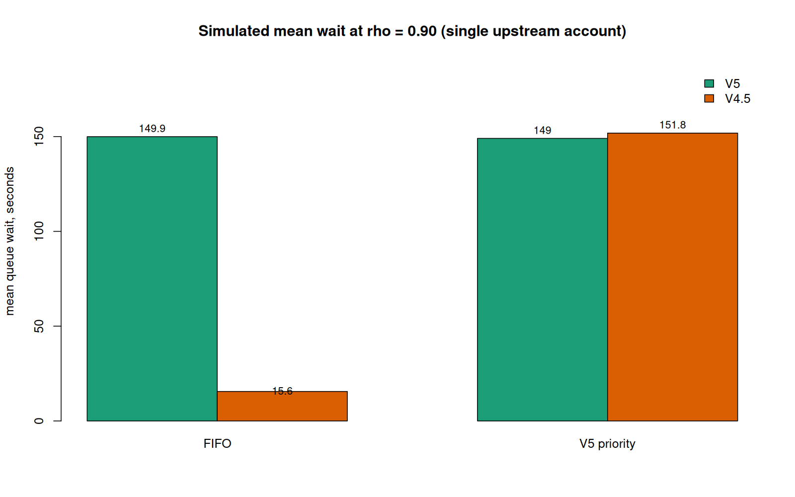

# V5 要不要插队：日志证据 + 排队机制 roadmap

生成：2026-11-07 17:00 (+08:00)
数据：`owl-new:/opt/service-tools/data/nai_gate.db`（`sqlite3 -readonly`，库内可用窗口 **2026-11-06 08:00 → 11-07 16:51，约 33 小时**）
脚本：`owl-monitor/r/v5-vs-45.R`（分析工作区在 `/Users/davidzhao/purge/purgedsh/owl-monitor/`）（base R，无第三方包）；原始输出 `owl-monitor/stats/v5-vs-45.txt`；数据 `owl-monitor/data/usage-14d.csv`

---

## 0. 一句话

**v5 快，而且快得稳定**：中位 3.9 s vs v4.5 的 8.9 s，均值 4.1 s vs 19.7 s，最长 9.7 s（v4.5 最长 52.3 s）；控制尺寸、步数、时段后仍然快 **64.6%**（95% CI 60.3%–68.5%）。但现在 v5 在队列里**没有任何优待**（等待 p = 0.526），它把自己 4 秒的活也排进 30 秒的队里。允许 v5 非抢占优先，模拟结果是：**v5 平均等待 −89.6%，v4.5 只 +1.9%**（理论放大上界 1.019 倍）。

---

## 1. 样本

| 项 | 值 |
|---|---|
| 窗口 | 2026-11-06 08:00 → 11-07 16:51（33 小时，库只保留这么久） |
| ok | 4,653（v5 305 / v4.5 4,149 / v4 1） |
| rejected | 3,142 `queue_full`、221 `queue_timeout`、188 `key_rate`、186 `member_quota` |
| cancelled | 327（`client_disconnected`） |
| 当前参数 | `queue_timeout=90`、`queue_per_account=8`、`queue_per_member=3`、`account_daily_cap=4800` |

`dur_ms` 的定义先钉死：`crates/gate-server/src/reqctx.rs:318` —— `wait_ms` 是收到请求到发往上游，`dur_ms` 是**发往上游之后的往返**。下面的"耗时"一律指 `dur_ms`，不含本地排队。

上游并发也钉死了：33 小时内 4,454 条 ok 记录，按 `[ts-dur, ts]` 区间两两比对，**重叠 0 次** → 单账号、严格串行。

---

## 2. 耗时：分布、检验、分层

### 2.1 总体

| | n | 均值 | 中位 | p25 | p75 | p90 | p99 | 最大 | sd |
|---|---|---|---|---|---|---|---|---|---|
| **v5** | 305 | **4.10** | **3.89** | 2.92 | 4.98 | 6.13 | 9.12 | **9.74** | 1.55 |
| **v4.5** | 4,149 | **19.74** | **8.92** | 5.48 | 35.37 | 42.30 | 47.62 | **52.29** | 15.97 |

v5 的上界（9.7 s）比 v4.5 的 p25（5.5 s）高一点，但低于 v4.5 的 p75（35 s）一大截；v4.5 的 sd 是均值的 0.8 倍，v5 只有 0.38 倍。

### 2.2 同尺寸、同步数（排除"v5 只出小图"）



| 尺寸/步数 | v4.5 中位 | v5 中位 | 倍数 | Wilcoxon p | Cliff's δ |
|---|---|---|---|---|---|
| 832×1216 / 23 | 5.23 | 3.93 | 1.3× | 6.5e-04 | 0.197 |
| 832×1216 / 28 | 10.81 | 4.98 | **2.2×** | 1.3e-19 | 0.698 |
| 1216×832 / 23 | 3.84 | 3.58 | 1.1× | 0.153（**不显著**） | 0.087 |
| 1216×832 / 28 | 12.39 | 5.48 | **2.3×** | 5.5e-04 | 0.634 |
| 1024×1024 / 28 | 9.09 | 3.00 | **3.0×** | 1.2e-11 | 0.758 |

**要如实说**：23 步的 1216×832 这一组两者几乎一样快（3.8 vs 3.6 s，p=0.15）。v5 的优势不在"每一步都更快"，而在**高步数/大图时不进长尾**。23 步那组 v4.5 本来就没进长尾。

### 2.3 整体检验

| 检验 | 结果 |
|---|---|
| Wilcoxon 秩和（H1：v5 更快） | W = 195,050，**p = 5.7e-91** |
| 中位数差 | **5.03 s**，bootstrap 95% CI [4.61, 5.61] |
| Cliff's δ | **0.692**（>0.474 即大效应） |

### 2.4 控混杂：log(dur) 回归

`log(dur_ms) ~ v5 + steps + log(px) + 时段`（n=4,454，R²=0.192）：

```
v5 系数 = -1.039  [-1.154, -0.924]
→ 同等尺寸、步数、时段下，v5 快 64.6%（95% CI 60.3% ~ 68.5%）
```

### 2.5 尾部才是重点



v5 的曲线在 10 s 前就贴到 1.0；v4.5 在 10 s 时才走到 54%，然后在 **10–26 s 之间几乎水平**，再从 26 s 爬到 48 s 才收尾。这不是"慢一点"，是**有一批请求被固定拖到 26–48 秒**。



按小时看更清楚：v4.5 的中位在凌晨 3–6 点只有 3.5–4 s，白天回到 25–29 s，16 时和 18 时又掉到 8 s；v5 全天稳定在 3–6 s。**v5 的耗时不随上游压力漂移**，这正是排队调度最想要的性质。

---

## 3. 排队现状：v5 一点优待都没有



| | n | 均值 | 中位 | p90 | 最大 |
|---|---|---|---|---|---|
| v5 | 305 | 29.8 s | 21.6 s | 71.5 s | 89.7 s |
| v4.5 | 4,149 | 33.2 s | 30.9 s | 75.6 s | 130.5 s |

两条 ECDF 基本重合（Wilcoxon **p = 0.526**）。等待/生成比：**v5 是 5.6 倍，v4.5 是 3.5 倍** —— v5 用户等的时间是自己出图时间的 5 倍以上。

当时的排序在 `crates/gate-upstream/src/pace.rs:fair_cmp`：只看「今天出得少」+ 到达时间 + 防饿死老化，**没有模型维度**（「今天出得少」这一层 11-07 当天已删除，见 §5.1）。`live.rs:214` 对外也就写死报 `mode: "fifo"`。

---

## 4. 插队值不值：排队论算给你看

用实测服务时间（dur + post_jitter 1–3 s）做输入，单账号、并发 1、忙时 ρ=0.90（λ≈157 张/h，与实测单账号上限一致），**同一组到达和服务时间，只换调度策略**：

| 调度 | v5 平均等待 | v4.5 平均等待 |
|---|---|---|
| FIFO（现状） | 149.9 s | 149.0 s |
| v5 非抢占优先 | **15.6 s（−89.6%）** | **151.8 s（+1.9%）** |



理论上界对得上：v5 只占忙时的 **ρ_v5 = 1.8%**，非抢占优先级给低优先级带来的放大正好是 `1/(1−ρ_v5) = 1.019` 倍。所以：

- **v4.5 的代价有硬上界 1.9%，不是"感觉上被插队"**；
- **v5 拿回 89.6% 的等待时间**，因为它再也不用排在 20 多张 4.5 后面；
- 这不是零和：v5 每张只吃 6.1 s，把它从队尾提到队首，系统总等待是净减少的（SRPT 性质）。

---

## 5. 结论与要落地的机制

**结论：允许 v5 插队，但只做非抢占、只在服务端判定、带开关。**

| 设计点 | 取值 | 理由 |
|---|---|---|
| 抢占与否 | **不抢占** | 打断正在生成的图会浪费已消耗的上游算力，且用户看到图重画 |
| 判定依据 | 模型族 `nai-diffusion-5-*` | 服务端读请求体 `model`，客户端参数/请求头不能指定 |
| 老化 | 保留现有 `patient_at`（等满半个 timeout，现为 45 s 就跳到最前） | 4.5 不会被饿死；这条比优先级更早生效 |
| 开关 | `guard_v5_priority`（0/1，默认 1） | 一行设置热更新，出问题秒回滚 |
| 位次显示 | 复用同一个 `fair_cmp` | 选号、换号、`/public/live` 位次、`ahead_of` 全部同源，不会出现"显示第 3 实际第 8" |

实现在同目录的 `ROADMAP.md` §6「11-07：V5 短作业车道」有完整落点表。

---

### 5.1 上线实测（2026-11-07 当天，两版）

**第一版 17:51 上线**（老化排在车道前），立刻暴露一个设计错误：拥塞时几乎每张 4.5 都过了 45 秒，老化的普通请求把 V5 全挡住了。

| 证据 | 数据 |
|---|---|
| 18:05:35 到达的 V5 | 等了 **52 秒**才发 |
| 18:06:32 到达的 V5 | 等了 **79 秒** |
| 派发时排在它前面的普通请求 | 0 个（卡住它的是「等待期间陆续开始、并在它之前完成」的那些已老化请求） |
| 第一版 12 张 V5 | 平均 **15 秒**、最大 78 秒；同期 68 张 4.5 平均 41 秒 |

**第二版 18:23 上线**：老化拆成两档 —— 半个超时（45 秒）只在同车道内抢先，整个超时（90 秒）才允许跨车道。

| 证据 | 数据 |
|---|---|
| 18:25:30 起的 3 张 V5 | 分别等 **1.1 / 2.0 / 0.7 秒**，各自越过 1–2 个已等 23–26 秒的普通请求 |
| 第二版 4 张 V5 | 平均 **3.7 秒**、最大 11.1 秒；同期 14 张 4.5 平均 31 秒 |
| 车道开关 | `/opt/owl/nai-ops get v5_priority` → `1`，回滚一条命令 |

**同时补掉的三处配套**（第一版漏的）：
1. `nai-ops` 的设置名是手写白名单，新参数根本不被认识 —— 回滚命令会直接报「未知设置名」；
2. 后台「额度与保护」页没有短标签，字段会掉进兜底的「其他」组；
3. `deploy/ops/SYSTEM-FACTS.md` 的参数表没写这一项。

**仍待观察**：
- 队列满（`queue_full`）时 V5 与 4.5 一样秒拒 —— 准入层与模型无关，V5 的短作业优势在这里用不上，属 P3 分池；
- 上游 V5 余量低（`V5 low allowance` 告警，11%）与本次改动无关，但会限制 V5 的可用量；
- 第二版样本只有 4 张，需要再看一个高峰。

---

## 6. 排队机制 roadmap（摘要）

| 阶段 | 内容 | 验收 |
|---|---|---|
| **P0 存量** | 90 s 排队超时、每人 3 张、前端计时条、SSE 心跳（Issue #8，分支 `fix/queue-heartbeat` 待发版） | 断连率回落；120 s 硬超时占比下降 |
| **P1 本周** | v5 非抢占优先 + `guard_v5_priority` 开关 + 位次同源 | 24 h 内 v5 `wait_ms` 中位 −50% 以上，v4.5 上升 ≤5% |
| **P2** | 心跳帧带 `{pos, eta_s}`；前端显示「前面 N 张，约 M 秒」；429 按钮冷却（Issue #10） | 排队期刷新导致的 `client_disconnected` 归零 |
| **P3** | 分池调度（DRR）：按模型族/额度池分配上游节拍，`mode` 从 `fifo` 切 `drr` | 单账号下 v5 有独立节奏，不挤压 4.5 吞吐 |
| **P4** | 第二上游账号；实测 v5 是否与 4.5 共享上游并发锁（若独立可并行而非插队） | 吞吐 145 → 280 张/h |
| **P5** | 告警通道（Issue #9）：断连率、`queue_full` 比、V5 余量、磁盘 | 越线 5 分钟内有人被喊 |

---

## 7. 复跑

```bash
# 1. 导出（服务器只读）
ssh owl-new "sqlite3 -readonly -csv -header /opt/service-tools/data/nai_gate.db \
  \"select ts,model,status,kind,images,wait_ms,dur_ms,up_status,detail from usage_log \
    where kind in ('image','image_stream') and ts >= strftime('%s','now') - 86400*14 \
      and (model like 'nai-diffusion-5-%' or model like 'nai-diffusion-4-5-%')\" > /tmp/usage-14d.csv"

# 2. 分析（R ≥ 4.0，base R 即可）
Rscript r/v5-vs-45.R data/usage-14d.csv .
```

## 8. 限制

- 库只保留 33 小时，样本是**当前这波负载**（v5 305 张）。v5 的 23 步大横图只有 58 张，那一组的结论（1.1×、不显著）置信度有限。
- `dur_ms` 含上游自己的排队，所以 v4.5 的长尾可能来自 NAI 侧对旧模型的限速，而不只是模型计算量。**不影响结论**：调度只关心"占住这个账号多久"，26–48 s 就是占住了。
- 模拟假设到达是泊松、服务独立同分布；真实到达有日内波动，ρ 峰值可能高于 0.90，此时 v4.5 的代价会比 1.9% 稍大，但量级不变。
